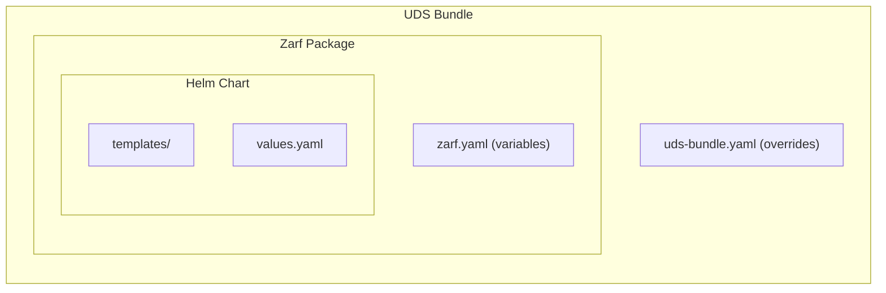

# Neutrino ⚛️

**Static Analysis & Introspection for Helm Charts, Zarf Packages, and UDS Bundles.**

---

Neutrino is a developer tool that helps engineers working with **Helm charts**, **Zarf packages**, and **UDS Bundles** understand and manage their configuration surfaces.

It statically analyzes Helm template ASTs to discover the *actual* values used in templates, displays Zarf variables alongside chart values, and provides both CLI and interactive TUI modes for exploring, searching, and navigating configuration across the entire packaging stack.

## Why "Neutrino"?

Neutrinos pass through almost everything — yet we've built detectors to observe them. Similarly, Helm values thread invisibly through layers of templates, packages, and bundles. **Neutrino makes those hidden configuration paths visible.**

## The Problem

Understanding the configurable surface of a Helm chart, Zarf package, or UDS Bundle traditionally requires:

1. Reading `values.yaml` — which often contains unused defaults or misses hidden values entirely.
2. Manually reading thousands of lines of Go template YAML spread across multiple charts and packages.
3. Cross-referencing Zarf variables, bundle overrides, and chart values by hand.

Neutrino solves this by acting as a **compiler frontend**. It parses templates just like Helm does, walks the syntax tree, and tracks every reference to `.Values` — then correlates those references with Zarf variables and package metadata.

## Key Capabilities

| Capability | Description |
|:---|:---|
| **True Usage Detection** | Finds values used in templates, even if they aren't in `values.yaml`. |
| **Dynamic Path Resolution** | Understands `range`, `with`, and variable assignments to resolve complex paths like `ingress.hosts.*.paths.*.path`. |
| **Source Attribution** | Tells you exactly _where_ a value is used (file, line, column) and _how_ (direct field access vs. variable assignment). |
| **Zarf Variable Mapping** | Surfaces Zarf package variables with their defaults, descriptions, and template locations. |
| **Multi-Package Support** | Analyze entire Zarf packages and UDS Bundles in one command — all components and charts are inspected together. |
| **Interactive TUI** | Explore values in a searchable, navigable terminal interface with support for filtering and in-editor jumping. |

## How It Works

Neutrino standardizes introspection across three packaging layers:

1. **UDS Bundles** — Top-level packages containing multiple Zarf packages.
2. **Zarf Packages** — Intermediate packages containing Helm charts and components.
3. **Helm Charts** — The deployment unit, containing templates and parameterizable `values.yaml` files.

Instead of making you fully pull a repository, untar its contents, and manually read template files, Neutrino:

- Transparently fetches exactly what it needs (often using OCI layer isolation).
- Parses the template AST to discover what dynamic paths exist and how they bind to defaults.
- Compiles a unified map of variables and configuration options up the hierarchy.

## Lean by Design

Neutrino is built to be fast, cache-friendly, and portable. It automatically avoids heavy networking operations when it doesn't need to rebuild intermediate abstractions. See the [Architecture](package-handling.md) section for details on how Neutrino differentiates between input formats, how its [caching system](caching.md) accelerates workflows, and how the [AST Walker](ast-walker.md) unearths variables that traditional parsing misses.

!!! tip "Quick Start"
    Head to [Getting Started](getting-started.md) to install and run your first inspection.
