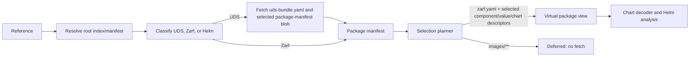

# OCI package-layer redesign

## Decision

Replace Neutrino's package-level `pull then extract` workflow with a **manifest-first, demand-driven package reader**. It should resolve a root manifest, fetch only the explicitly selected metadata and component descriptors, and present those bytes through a read-only virtual package view. It must not retrieve `images/**` descriptors unless a future operation explicitly requests image information.

This preserves the current inspect contract: charts, templates, defaults, Zarf values files, variables, and UDS overrides remain available. It deliberately does **not** promise file-level random access into a selected compressed Helm chart; Helm chart content remains one opaque gzip-tar OCI layer.

## Observed Neutrino behavior

### Direct remote Zarf package: full package transfer and extraction

`InspectZarfPackage` calls `PullZarfPackage` for a remote source, which calls Zarf's `packager.Pull`; it then calls `archive.Decompress` on the returned archive into the persistent package cache. No Neutrino layer-selection predicate reaches `packager.Pull`. Thus every descriptor that the upstream pull copies is eligible for transfer and the archive is fully materialized before `zarf.yaml` or a component is examined. [Current source: `src/pkg/helm/introspect/zarf.go#L17-L36`](../src/pkg/helm/introspect/zarf.go#L17-L36), [`#L96-L124`](../src/pkg/helm/introspect/zarf.go#L96-L124).

After extraction, Neutrino reads `zarf.yaml`, then expands each `components/<component>.tar`; it expands each selected chart archive again before Helm loads it. This creates package extraction plus component extraction plus chart extraction I/O, even though neither the package's embedded images nor a whole package tree is needed by the analysis. [Current source: `zarf.go#L126-L246`](../src/pkg/helm/introspect/zarf.go#L126-L246).

### Remote UDS bundle: selective remote transfer, but broad package reconstruction

The bundle path is better: `PullUDSBundle` resolves/fetches the root manifest and fetches only the layer titled `uds-bundle.yaml`. [Current source: `src/pkg/helm/introspect/uds.go#L64-L120`](../src/pkg/helm/introspect/uds.go#L64-L120). For an embedded package, it fetches the package-manifest bytes from the matching root layer, skips titles beginning `images/`, and writes every other package descriptor to `extracted-packages/<name>`. [Current source: `uds.go#L251-L310`](../src/pkg/helm/introspect/uds.go#L251-L310).

That avoids image payload transfer, but it still retrieves unrelated non-image package files, writes a reconstructed tree, and hands it to the legacy directory-oriented `InspectZarfPackage`. Errors fetching individual package descriptors are logged and inspection continues, so the reconstructed package is not an explicitly validated snapshot. [Current source: `uds.go#L281-L307`](../src/pkg/helm/introspect/uds.go#L281-L307), [`uds.go#L434-L438`](../src/pkg/helm/introspect/uds.go#L434-L438).

### Local archives: full extraction

Local Zarf archives are decompressed into `zarf-pkgs`; local UDS archives are decompressed into `uds-bundles` before the OCI layout and required blobs are read. [Current source: `zarf.go#L61-L124`](../src/pkg/helm/introspect/zarf.go#L61-L124), [`uds.go#L191-L212`](../src/pkg/helm/introspect/uds.go#L191-L212). This is unnecessary disk materialization when an archive reader can stream until it reaches the needed member, but generic compressed tar ordering prevents a universal small-read guarantee.

### Helm imposes the irreducible selected-chart boundary

Helm introspection requires chart templates and the chart's `values.yaml`: Neutrino loads the chart, analyzes templates, and indexes `values.yaml`. [Current source: `src/pkg/helm/introspect/introspect.go#L27-L41`](../src/pkg/helm/introspect/introspect.go#L27-L41), [`#L175-L197`](../src/pkg/helm/introspect/introspect.go#L175-L197). A selected chart archive therefore must be transferred and decompressed; eliminating package images does not eliminate this necessary chart-content transfer.

## Format facts and constraints

1. An OCI image manifest provides a config descriptor and an ordered list of layer descriptors. Descriptor metadata includes media type, digest, byte size, and annotations; clients can choose descriptors after fetching the small manifest. OCI explicitly permits non-image artifacts to use an image manifest with artifact-specific config/layer media types. [OCI Image Spec v1.1.1: manifest](https://github.com/opencontainers/image-spec/blob/v1.1.1/manifest.md#image-manifest), [artifact guidance](https://github.com/opencontainers/image-spec/blob/v1.1.1/manifest.md#guidelines-for-artifact-usage).
2. A registry exposes manifests and digest-addressed blobs separately. `GET /v2/<name>/manifests/<reference>` obtains the manifest; `GET /v2/<name>/blobs/<digest>` obtains exactly the chosen blob. Clients should verify a requested blob's digest. `Range` resumes blob bytes; it is not a file API for the contents of a compressed layer. [OCI Distribution Spec v1.1.1: pulling manifests and blobs](https://github.com/opencontainers/distribution-spec/blob/v1.1.1/spec.md#pulling-manifests).
3. Helm defines the OCI chart config as `application/vnd.cncf.helm.config.v1+json`, chart content as `application/vnd.cncf.helm.chart.content.v1.tar+gzip`, and provenance as a separate optional layer. The chart layer contains `values.yaml`, so a client can omit provenance but cannot request `values.yaml` alone from a registry. [Helm v4.1.3 registry constants](https://github.com/helm/helm/blob/v4.1.3/pkg/registry/constants.go), [Helm chart loader](https://github.com/helm/helm/blob/v4.1.3/pkg/chart/loader/load.go).
4. Zarf remote OCI layout is file-descriptor based: Zarf creates a descriptor per assembled package file, uses `application/vnd.zarf.layer.v1.blob`, and records the package-relative filename in `org.opencontainers.image.title`. Its embedded images are an OCI layout beneath `images/`, so those files are independently selectable package descriptors. This is Zarf-format behavior, not a generic OCI guarantee. [Zarf v0.74.0 OCI assembly](https://github.com/zarf-dev/zarf/blob/v0.74.0/src/pkg/packager/layout/oci.go#L102-L225).
5. UDS remote bundles transport embedded Zarf package-manifest bytes as root-layer blobs for compatibility, rather than as registry manifest-endpoint children. A reader must fetch that selected root layer as a blob, parse its bytes as a package manifest, then select package descriptors. [UDS CLI bundle pusher](https://github.com/defenseunicorns/uds-cli/blob/main/src/pkg/bundler/pusher/remote.go), [UDS ADR 0009](https://github.com/defenseunicorns/uds-cli/blob/main/docs/adr/0009-bundle-media-types.md).

The prior format-focused research in [`oci-layer-behavior.md`](oci-layer-behavior.md) reaches the same descriptor-selection boundary and supplies pinned UDS/Zarf source links; the primary links above are the authority for this note.

## Target architecture

### Deep module boundary

Introduce an internal `PackageSource` reader rather than letting inspection code choose files, caches, OCI descriptors, and archive extraction. Its output is a descriptor-addressed read-only view, not an extracted directory.

- `Resolve(ctx, ref, platform) -> PackageRoot`: resolves an index once, pins the selected root digest, classifies by config/layer metadata, and exposes descriptors.
- `Plan(root, inspectionRequest) -> []Descriptor`: returns only control-plane, selected component, chart, and values descriptors. The plan rejects `images/` by default.
- `Fetch(ctx, descriptor) -> VerifiedBytes`: streams to a digest-verifying cache keyed by descriptor digest and returns a reader/path only after size and digest validation.
- `PackageView`: maps selected Zarf titles to verified bytes and exposes `ZarfYAML`, component archives, values files, and chart archives. It never claims arbitrary filesystem completeness.
- `ChartInput`: accepts a chart archive reader/path and custom values readers. It owns the one necessary chart decompression and eliminates the artificial directory handoff.

`InspectZarfPackage` and `InspectUDSBundle` become consumers of this same reader. UDS package-manifest layers are decoded by the UDS adapter; direct Zarf manifests by the Zarf adapter. Both produce the same `PackageRoot` and selection plan.

### Selection rules

1. Fetch root manifest/config only; resolve an index to the requested platform before payload transfer.
2. For UDS, fetch only `uds-bundle.yaml`, then only the root layer that carries each requested package manifest.
3. For each selected Zarf package, fetch `zarf.yaml` first. Use it to select only components/charts/values required by the inspection request. Fetch integrity/signature material if Neutrino adopts a trust policy.
4. Never select a title under `images/`. Add an explicit future `--include-images` capability rather than implicitly expanding this boundary.
5. For a selected Helm OCI chart, fetch its manifest/config and its one chart-content layer; omit provenance unless verification requests it. For a Zarf component tar containing a needed chart, fetch that component blob and stream/extract only the requested chart and values entries.
6. Cache immutable bytes by descriptor digest, not only by `URL + version + architecture`. Cache parsed/expanded chart results separately and record the root/package digest that produced them.

## Redesign options

| Option | Benefit | Risk | Recommendation |
| --- | --- | --- | --- |
| Keep upstream Zarf `Pull`; only retain current UDS image-title filter | No API work; UDS already avoids images | Direct Zarf remains full transfer/extract; duplicate retrieval logic | Reject as target |
| Add a Neutrino manifest-first `PackageSource` and virtual view | Avoids image descriptors for direct Zarf and UDS; unifies data flow; cache is content-addressed | Requires adapters and tests for package variants | **Choose** |
| Publish a new Neutrino-specific split metadata artifact | Could make control-plane retrieval a single small layer | Requires producer adoption; cannot fix existing Zarf/UDS packages; adds format surface | Optional future optimization only |

## Committed cutover scope

The first cutover covers **remote direct-Zarf packages and remote UDS bundles** only. It preserves inspection of every declared Helm chart and managed values file; it resolves exactly the requested platform and fails with the available platforms when none matches. A missing, unverifiable, or unsupported selected layout fails the complete command diagnostically—there is no automatic full-pull fallback.

Upgrade Zarf from v0.74.0 to v0.82.0 in a separate, behavior-preserving commit before this work. The reader owns its Package Root, descriptor-selection, verification, cache, and Package View contracts; it may use upstream transport primitives but does not use Zarf's selector as its architectural core. Cache bytes by verified descriptor digest, publishing each entry atomically; `--no-cache` bypasses cache reads and refreshes the resolved Package Snapshot. OCI descriptor digest/size verification is mandatory, but Zarf signature-policy configuration is not part of this redesign.

Local archive streaming and an explicit component/chart-selection interface are deferred. The latter is a candidate follow-up: it could substantially reduce transfers for bundles containing many packages or components, but must define partial-result and ordering semantics rather than silently changing today's all-charts inspection contract.

## Staged cutover

1. Add manifest classification and verified descriptor fetch behind `PackageSource`; retain the existing extract-based source as an oracle in tests.
2. Move remote direct Zarf to fetch `zarf.yaml` plus selected component descriptors. Assert no descriptor with an `images/` title is requested.
3. Move remote UDS to produce `PackageRoot` from its embedded package-manifest layer and delete the ad-hoc reconstructed-directory loop.
4. Add archive-backed `PackageSource`: stream local tarballs to required members; retain full extraction only where a legacy path still requires it. Do not depend on tar member ordering for generic Zarf archives.
5. Replace directory-based chart handoffs with archive/reader input, then delete full package extraction and old URL/version cache entries after migration.

## Verification criteria

Use a registry test fixture containing one small chart and large `images/blobs/sha256/*` descriptors. For direct Zarf and embedded UDS paths, assert: selected chart results match the legacy inspection output; fetched-descriptor logs contain `zarf.yaml`, chosen component/chart/value descriptors, and no `images/` title; every consumed blob passes digest and size verification; a cache hit issues no blob GET; an OCI Helm chart fetches its chart-content layer but not provenance by default. For local archives, compare streamed results with legacy full extraction and measure that image members are never written to the Neutrino cache.
